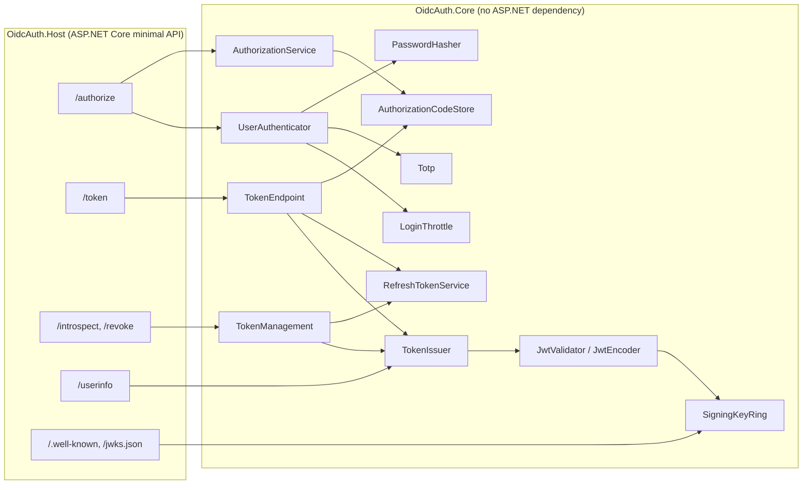

# oidc-authserver-cs

An OAuth 2.0 / OpenID Connect authorization server written in C# on .NET 8. The JWT signing and
validation, password hashing, TOTP, PKCE, and refresh-token handling are implemented here on top of
`System.Security.Cryptography`. No identity framework or JWT library is used. A small ASP.NET Core
minimal-API host exposes the standard endpoints.

I built it to work through the parts of authentication that are easy to get subtly wrong:
algorithm-confusion attacks on JWTs, authorization-code replay, refresh-token theft, account enumeration,
brute force, and races between concurrent requests that present the same credential.

## What it does

| Area | Implementation | Spec |
|---|---|---|
| JWS tokens | ES256 / RS256 / HS256 signing and strict validation; `alg` is bound to the key, so the token header can't pick it; `none` and `crit` are rejected, as are duplicate JSON members | RFC 7515, 7519, 8725 |
| Access tokens | JWT access tokens with `typ: at+jwt`, `jti`-based revocation denylist | RFC 9068 |
| ID tokens | `nonce`, `auth_time`, `at_hash` | OIDC Core 1.0 |
| Keys | Key ring with rotation. Retired keys keep verifying, and stay in the JWKS, until every token they signed has expired. `kid` = JWK thumbprint | RFC 7517, 7638 |
| Authorization code | Single use. A replayed code revokes the tokens from the first redemption. Exact redirect-URI match; `iss` returned in the response | RFC 6749 §4.1, RFC 9207 |
| PKCE | Required for every client, `S256` only | RFC 7636 |
| Refresh tokens | Rotated on every use, with family-based reuse detection, idle and absolute lifetimes, and down-scoping | RFC 9700 §4.14 |
| Client auth | `client_secret_basic`, `client_secret_post`, or `none` (public clients). Exactly one method per request | RFC 6749 §2.3 |
| Introspection / revocation | Confidential clients only for introspection. Revocation doesn't reveal whether a token existed | RFC 7662, 7009 |
| Passwords | PBKDF2-HMAC-SHA256, 600,000 iterations, self-describing format, automatic rehash on login. Unknown users still cost a full hash | OWASP |
| MFA | TOTP/HOTP (SHA-1/256/512), ±1 step window, replay protection, `otpauth://` provisioning URIs | RFC 4226, 6238 |
| Brute force | Per-username and per-IP lockouts with exponential backoff; the host returns `429` + `Retry-After` | |

## Running it

Requires the .NET 8 SDK.

```bash
dotnet test                                                   # 130 tests
dotnet run -c Release --project bench/OidcAuth.Bench          # full benchmark
dotnet run -c Release --project bench/OidcAuth.Bench -- --quick
dotnet run --project src/OidcAuth.Host --urls http://localhost:5080
```

On startup the host seeds two demo clients and two users. It logs a random password, the `demo-backend`
client secret, and a TOTP provisioning URI for `bob`. To try it:

```bash
curl -s localhost:5080/.well-known/openid-configuration
curl -s localhost:5080/jwks.json
curl -s -u "demo-backend:<secret from log>" -d grant_type=client_credentials localhost:5080/token

# Authorization code + PKCE for the public client "demo-spa"
VERIFIER=$(head -c 32 /dev/urandom | base64 | tr '+/' '-_' | tr -d '=')
CHALLENGE=$(printf %s "$VERIFIER" | openssl dgst -sha256 -binary | base64 | tr '+/' '-_' | tr -d '=')
curl -si localhost:5080/authorize -d response_type=code -d client_id=demo-spa \
  -d redirect_uri=http://localhost:5173/callback -d scope="openid profile offline_access" \
  -d code_challenge=$CHALLENGE -d code_challenge_method=S256 -d state=xyz \
  -d username=alice -d password=<password from log> | grep -i location
curl -s localhost:5080/token -d grant_type=authorization_code -d client_id=demo-spa -d code=<code> \
  -d redirect_uri=http://localhost:5173/callback -d code_verifier=$VERIFIER
```

## Architecture



`OidcAuth.Core` contains all the protocol logic. It is transport-independent: `TokenEndpoint.Handle` takes
a form dictionary and optional Basic credentials and returns either a `TokenResponse` or an RFC 6749 error.
That keeps it unit-testable and lets the benchmark call it directly. The host only parses HTTP, sets
`Cache-Control: no-store`, and maps errors to status codes. A background service prunes expired codes,
tokens, denylisted JTIs, and retired keys once a minute. All time-dependent code takes a `TimeProvider`, so
the tests run on a manual clock.

Bearer secrets such as codes and refresh tokens are 256-bit random values. The server stores only their
SHA-256 hashes, so a memory or database dump doesn't hand out usable credentials.

### Replay and race handling

- **Authorization codes.** A redeemed code stays behind as a tombstone. A second redemption marks the entry
  compromised, which revokes the refresh-token family and denylists the access token from the first
  redemption. If the replay arrives while the first redemption is still issuing tokens, the first redeemer
  checks the flag after recording what it issued, and revokes those tokens itself.
- **Refresh tokens.** Each token is consumed with an atomic exchange. Presenting a consumed token revokes
  the whole family. A revocation that races with a rotation is caught by re-checking the family after the
  successor is stored.
- **TOTP.** The last accepted time step is advanced with compare-and-swap, so two logins can't both use
  the same code.

## Tests

130 xUnit tests, including:

- Published test vectors: RFC 6238 (all 18 TOTP values across SHA-1/256/512), RFC 4226 HOTP, RFC 7636
  PKCE, the RFC 7638 JWK thumbprint, and RFC 4648 base32.
- JWT attacks: `alg: none` in any casing, RS256→HS256 key confusion, tampered payloads and signatures, an
  unknown `kid`, duplicate header members, `crit`, expiry/nbf/iat with clock skew, and the wrong
  issuer/audience/`typ`.
- Protocol rules: never redirecting to an unregistered URI, consuming a code on a failed PKCE attempt, code
  replay revoking tokens, refresh reuse killing the session, scope escalation, client binding, and the
  30-day absolute refresh lifetime.
- Concurrency: 200 rounds of 8 parallel redemptions of one code, and 200 rounds of 8 parallel rotations of
  one refresh token.
- HTTP integration through `WebApplicationFactory`: the full code flow, JWKS-based validation as a separate
  resource server would do it, userinfo, revocation, Basic auth, MFA, and `429` lockouts.

## Benchmark results

Produced by `dotnet run -c Release --project bench/OidcAuth.Bench` on an Apple-silicon Mac (.NET 8.0.33,
macOS, arm64, 28 logical CPUs). Everything runs in-process with no HTTP, so these numbers measure the auth
logic, not Kestrel. Single-thread rows time each operation individually; the multi-thread rows report
aggregate throughput only.

| operation | ops | ops/sec | p50 µs | p99 µs |
|---|---:|---:|---:|---:|
| JWT sign ES256 | 40,000 | 10,071 | 98.5 | 123.0 |
| JWT validate ES256 | 40,000 | 10,589 | 91.7 | 123.4 |
| JWT sign RS256 | 4,000 | 1,068 | 925.1 | 1,040.6 |
| JWT validate RS256 | 4,000 | 47,983 | 20.2 | 26.5 |
| JWT sign HS256 | 40,000 | 704,363 | 1.2 | 2.4 |
| JWT validate HS256 | 40,000 | 305,483 | 3.1 | 4.2 |
| PBKDF2-SHA256 verify (600,000 iter) | 20 | 12 | 82,851.9 | 87,718.7 |
| TOTP verify (window ±1) | 100,000 | 673,370 | 1.4 | 1.9 |
| code+PKCE flow, 1 thread | 10,000 | 4,915 | 197.5 | 271.7 |
| code+PKCE flow, 28 threads | 40,000 | 57,062 | – | – |
| token requests (1 code + 3 refresh rotations), 28 threads | 40,000 | 90,186 | – | – |

| race-safety check (8 threads replay the same credential at once) | trials | trials where any raced request left a usable token |
|---|---:|---:|
| authorization code double-redeem | 2,000 | 0 |
| refresh token double-rotate | 2,000 | 0 |

How to read the results:

- **The code flow is dominated by signing.** The flow signs two ES256 JWTs, the access token and the ID
  token, at about 98 µs each, which accounts for nearly all of the 197.5 µs p50.
- **ES256 vs RS256.** ES256 signs about 9× faster than RS256-2048, but RS256 verifies about 4.5× faster.
  Resource servers verify far more often than the auth server signs, so RS256 is a reasonable choice when
  verification load dominates.
- **Login throughput is limited by the password hash.** At 600,000 iterations, one PBKDF2 verification
  costs about 83 ms of CPU per core. That cost is intentional, and the reason the lockout refuses requests
  before hashing.
- **Platform matters.** The crypto backend differs by OS (Apple's frameworks on macOS, OpenSSL on Linux),
  so absolute numbers will differ elsewhere. CI runs the `--quick` variant on Linux on every push.

## Limitations

- **Headless `/authorize`.** Credentials are posted directly with the authorization request. There is no
  login or consent UI, no session cookie, and no `prompt`/`max_age` handling. A browser deployment would put
  a login page in front of the same `AuthorizationService`.
- **In-memory storage.** Users, clients, codes, refresh tokens, and the JTI denylist live in memory. A
  restart logs everyone out, and you can't run more than one instance behind a load balancer. The stores
  are behind small classes, but there is no database or Redis implementation.
- **Keys aren't persisted.** Signing keys are generated at startup and not loaded from a KMS or HSM, and
  there is no scheduled automatic rotation (`SigningKeyRing.Rotate` exists but nothing calls it on a timer).
- **Unimplemented OIDC features.** No dynamic client registration, PAR, DPoP/mTLS sender-constrained tokens,
  logout, consent records, or pairwise subject identifiers.
- **Throttles are per process.** Lockout state isn't shared between instances, and the per-IP key trusts
  `RemoteIpAddress`, so a reverse proxy needs forwarded-header configuration.
- **Unaudited.** Nobody has reviewed this code for security, so don't use it to protect anything real.
